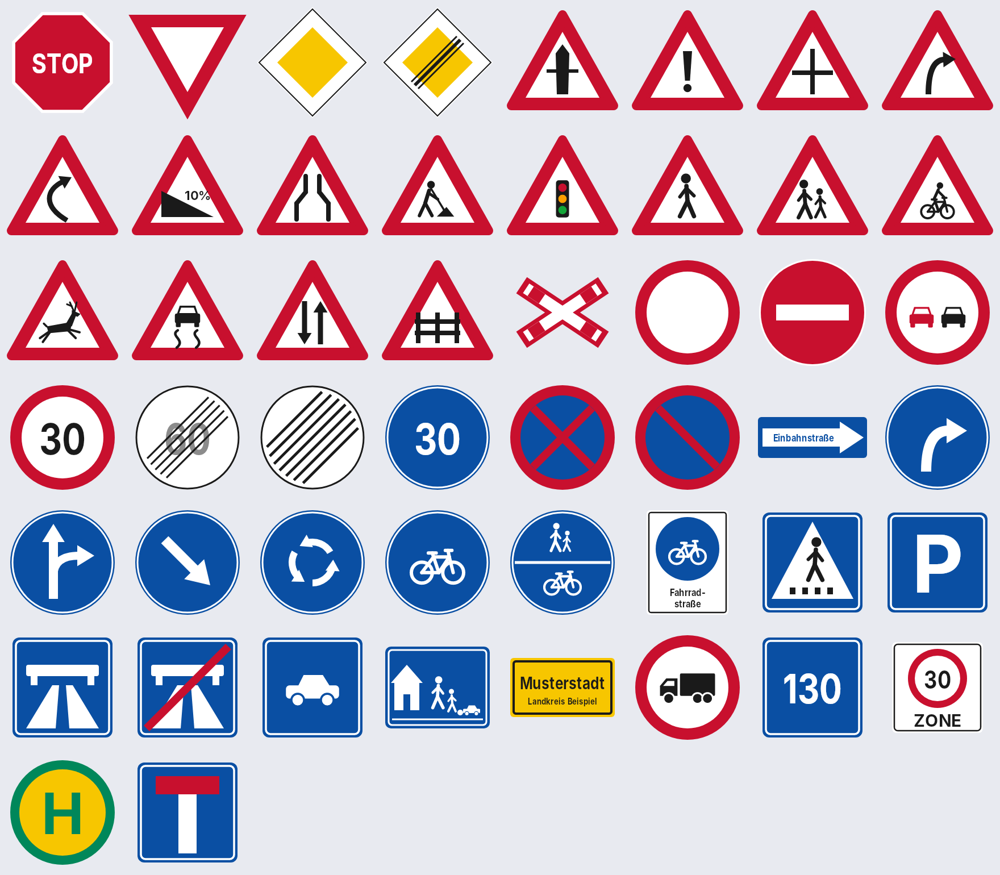
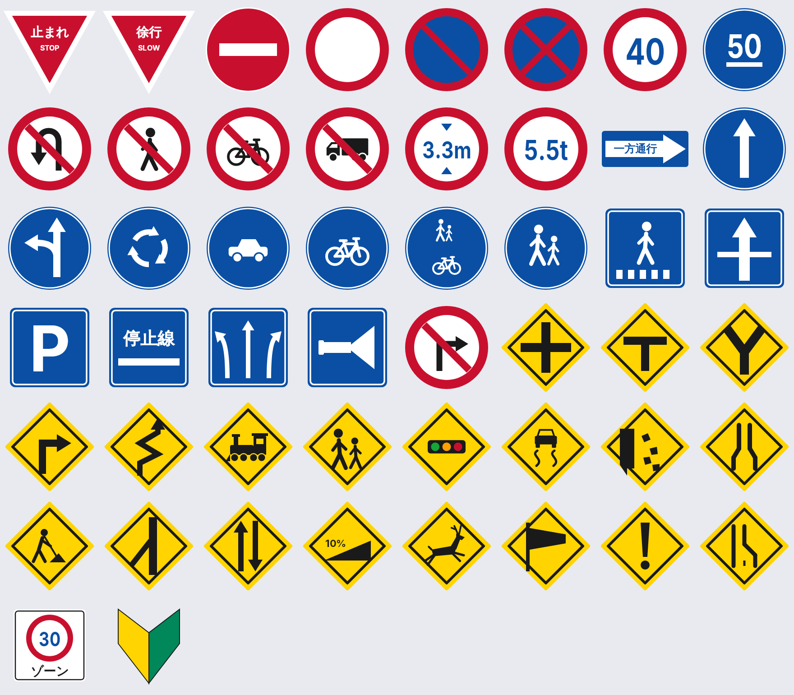
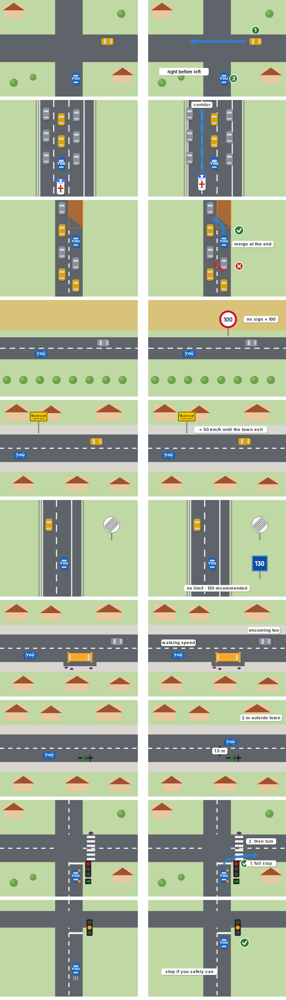
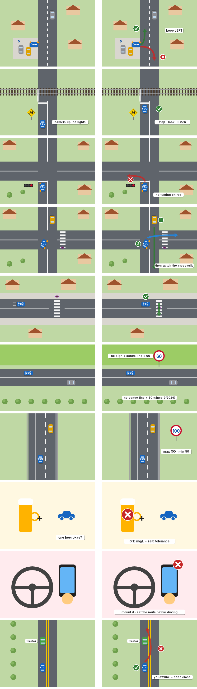

# CrashCourse

An Android app to help you get back into driving – in **Germany** or **Japan**.

Pick a country on the start screen and practise with multiple-choice quizzes:

| | 🇩🇪 Germany | 🇯🇵 Japan |
|---|---|---|
| Street signs | 50 | 50 |
| Traffic scenarios | 30 | 30 |

Every question has 4 options (shuffled each time) and shows a short explanation after you answer,
including the official local sign name (e.g. *Zeichen 205 – Vorfahrt gewähren!* or *一時停止（止まれ）*).

## Sign previews

| Germany | Japan |
|---|---|
|  |  |

## Scenario illustrations

Every scenario has a top-down illustration. Before you answer it shows the situation (left);
afterwards it shows the correct behaviour (right): paths, who goes first, distances, ✓ / ✗.

| Germany | Japan |
|---|---|
|  |  |

## Features

- **Country selection** at startup – German or Japanese signs and rules.
- **Street signs quiz** – run all 50 or a quick round of 10.
- **Traffic scenarios quiz** – right of way, Autobahn emergency corridor, Japanese railway crossings,
  turning on red, alcohol limits, licence requirements and more.
- **Review mistakes** – every wrong answer is saved; answer it correctly later to clear it.
- **How to behave** – every scenario with its illustration, the right behaviour and the reason.
- **All signs** – a grid of every sign with its meaning, for learning without pressure.
- Best score per category is remembered.

All signs are drawn in code (`app/src/main/java/com/crashcourse/app/signs/SignKit.kt`) as simplified
renderings, so no image assets or licensing issues are involved. They are close to the real designs
but not pixel-exact.

## Getting the APK

**First install:** open the repository's
[Releases page](https://github.com/dom1911k/CrashCourse/releases/latest), download
`CrashCourse.apk` on your phone and open it (allow installing apps from your browser when asked).

**Updating:** open the app – it checks for a newer build on startup and shows an
*Update available* card. You can also tap **Check for updates** at the bottom of the start screen.
Tap *Update now*, and Android's installer opens. The first time, Android asks you to allow
CrashCourse to install apps.

How it works: every push to the default branch runs the *Build APK* workflow, which builds the APK
and publishes it as a GitHub release tagged `build-<run number>`. The app's version code is that
same run number, so the app knows when a release is newer. All builds are signed with the same key
(`app/signing.keystore`), so Android accepts them as updates.

**With Android Studio:** open the project folder and press *Run*.

**From the command line** (needs JDK 17 and the Android SDK):

```sh
./gradlew assembleDebug
# APK: app/build/outputs/apk/debug/app-debug.apk
```

## Project layout

```
app/src/main/java/com/crashcourse/app/
├── MainActivity.kt
├── data/
│   ├── Model.kt              # Country, Category, Question, QuestionBank
│   ├── GermanySigns.kt       # 50 German signs (StVO)
│   ├── GermanyScenarios.kt   # 30 German scenarios
│   ├── JapanSigns.kt         # 50 Japanese signs (道路標識)
│   ├── JapanScenarios.kt     # 30 Japanese scenarios
│   └── ProgressStore.kt      # best scores + mistakes (SharedPreferences)
├── signs/SignKit.kt          # drawing toolkit for all signs
├── scenes/                   # top-down scenario illustrations (SceneKit + per-country scenes)
├── update/Updater.kt         # checks GitHub releases, downloads + installs updates
└── ui/                       # Jetpack Compose screens + theme
```

To add a question, append a `signQuestion(...)` or `q(...)` entry to the relevant data file –
each needs exactly one correct answer and three wrong ones.

> Rules change. The content reflects the rules as of 2026, but always check official sources
> (StVO / 道路交通法) before relying on a specific detail.
